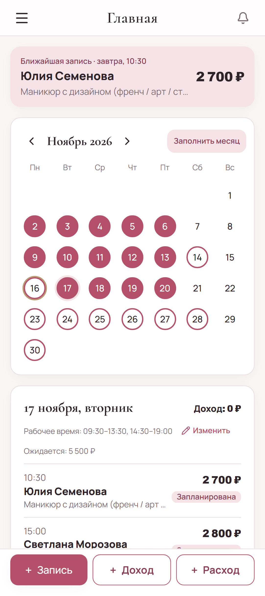
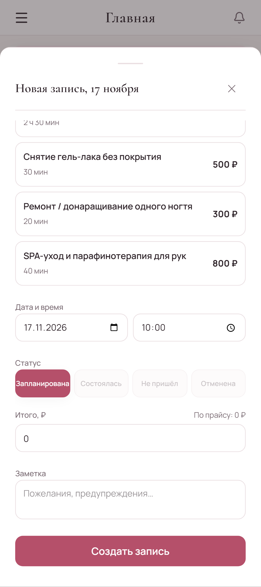
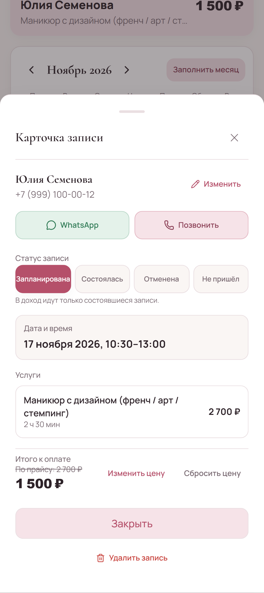
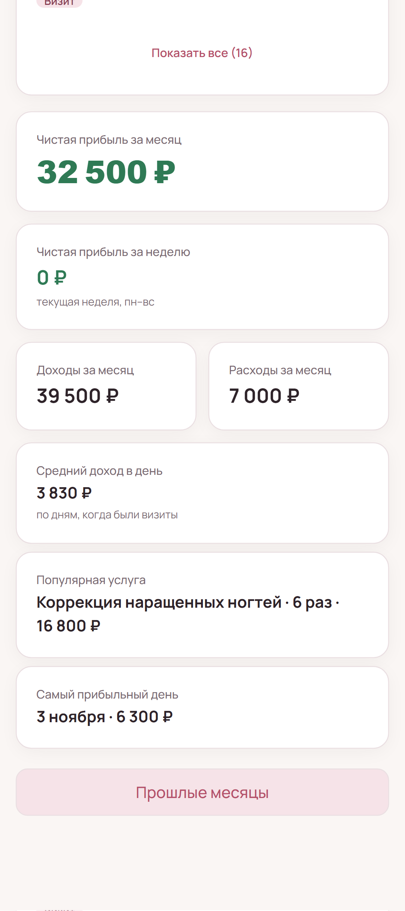
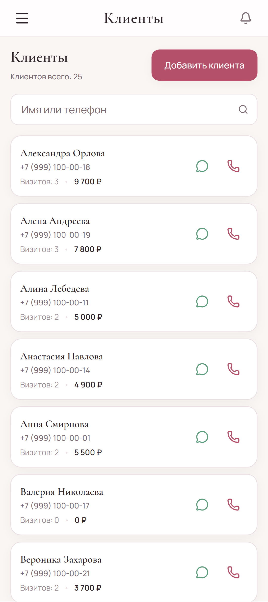

# Manicure Dashboard

<p align="center">
  
  
  
</p>
<p align="center">
  
  
</p>

Веб-приложение (dashboard) для мастера маникюра, рассчитанное на персональное использование с мобильных устройств (mobile-first). Система позволяет планировать визиты в календаре, настраивать рабочие окна, вести клиентскую базу с историей посещений и прайс-лист услуг. В приложении реализован раздельный учёт доходов от визитов, прочих поступлений и расходов с автоматическим расчётом чистой прибыли и статистики.

## Возможности

- **Календарь и рабочее время:** просмотр расписания по дням и месяцам, гибкая настройка рабочих окон мастера на выбранные даты, проверка пересечения слотов и предупреждение о записи вне рабочего графика.
- **Управление записями:** оформление, перенос и отмена визитов; выбор клиента и перечня услуг (поддерживается добавление нескольких одинаковых услуг); статусы записи (`scheduled`, `completed`, `cancelled`, `no_show`); автоматический расчёт длительности и стоимости по прайсу с возможностью ручной корректировки финальной цены.
- **Клиентская база:** хранение контактов и заметок, быстрый поиск по имени или телефону, просмотр истории визитов, мягкое удаление.
- **Каталог услуг:** настройка списка процедур с указанием цены и продолжительности, архивирование (деактивация) без влияния на исторические записи.
- **Учёт финансов и статистика:** раздельный учёт выручки от визитов, прочих доходов и расходов; расчёт чистой прибыли за месяц, среднего дохода за рабочий день, выявление самых прибыльных дней и наиболее востребованных услуг.
- **Демо-режим:** безопасное наполнение базы реалистичными тестовыми данными через CLI-команду для демонстрации интерфейса и скриншотов без риска перезаписи боевых данных.

## Стек технологий

- **Backend:** Python 3.12, FastAPI, SQLAlchemy 2.x (asyncio), asyncpg, Alembic, PostgreSQL 16, Pydantic v2, pydantic-settings, Argon2 (argon2-cffi), PyJWT.
- **Frontend:** React 19, TypeScript, Vite, Tailwind CSS v4, @tanstack/react-query, React Router v7, Lucide React, date-fns, @fontsource (шрифты Cormorant, Manrope).
- **Инфраструктура и DevOps:** Docker, Docker Compose, Caddy 2 (обратный прокси с автоматическим HTTPS и security-заголовками), Bash.
- **Тестирование и линтинг:** pytest, httpx, ruff (backend); Vitest, testing-library, oxlint (frontend).

## Архитектура

### Структура репозитория

- `backend/` — REST API на FastAPI:
  - `app/api/` — роуты приложения, сгруппированные по доменам;
  - `app/models/` — декларативные модели SQLAlchemy;
  - `app/schemas/` — схемы валидации и сериализации Pydantic;
  - `app/services/` — слой чистой бизнес-логики (расчёты, проверка пересечений, сидирование);
  - `app/core/` — конфигурация окружения, подключение к БД, безопасность;
  - `alembic/` — миграции схемы базы данных;
  - `tests/` — модульные и интеграционные тесты бэкенда.
- `frontend/` — одностраничное приложение (SPA):
  - `src/pages/` — экраны приложения (календарь, финансы, клиенты, услуги, авторизация);
  - `src/components/` — UI-кит и модальные формы (шторки);
  - `src/api/` — HTTP-клиент, интеграция с TanStack Query и типизация;
  - `src/lib/` — утилиты форматирования валюты, дат и телефонов.
- `docs/` — дизайн-система (`DESIGN.md`) и отчёты ревью кода (`reviews/`).
- `deploy/` — конфигурация Caddy (`Caddyfile`, `caddy.Dockerfile`).
- `scripts/` — скрипты резервного копирования и инструкции восстановления (`backup.sh`, `RESTORE.md`).

### База данных

Схема данных PostgreSQL состоит из 9 таблиц:

| Таблица | Назначение |
|---|---|
| `users` | Учётная запись владельца (логин и хеш пароля). |
| `settings` | Настройки салона (название, часовой пояс, шаг сетки календаря). |
| `services` | Справочник услуг (название, базовая цена в рублях, длительность, признак активности). |
| `clients` | Карточки клиентов (имя, телефон, заметки, метка мягкого удаления). |
| `work_windows` | Окна доступного рабочего времени мастера на конкретные даты. |
| `appointments` | Записи клиентов (клиент, временной интервал, статус, итоговая стоимость, флаг ручной цены). |
| `appointment_services` | Состав услуг визита со снимками цен и длительности на момент записи. |
| `income_entries` | Прочие доходы салона, не связанные напрямую с визитами (дата, сумма, источник). |
| `expense_entries` | Расходы на материалы и содержание кабинета (дата, сумма, категория, описание). |

### Ключевые архитектурные решения

- **Деньги — только целые числа:** все суммы хранятся в целых рублях (`int`), исключая ошибки округления чисел с плавающей точкой.
- **Временные метки в UTC:** время хранится в формате `timestamptz` в UTC. Конвертация в локальное время мастера происходит при отображении и агрегации отчётов на основе таймзоны из `settings`.
- **Мягкое удаление (soft delete):** записи и клиенты снабжаются полем `deleted_at`. Физически строки не удаляются для сохранения целостности финансовых отчётов (за исключением окон `work_windows`).
- **Снимки услуг (snapshots):** при создании записи в таблицу `appointment_services` сохраняются копии цены (`price_snapshot`) и длительности (`duration_snapshot`). Последующее изменение прайс-листа не меняет финансовые показатели прошлых периодов.
- **Advisory-блокировки PostgreSQL:** создание и редактирование записей защищены транзакционной блокировкой `pg_advisory_xact_lock`, что предотвращает состояние гонки (race conditions) при одновременной записи на один и тот же интервал времени.
- **Строгая генерация типов фронтенда:** типы TypeScript генерируются утилитой `openapi-typescript` напрямую из схемы OpenAPI работающего бэкенда (`npm run gen:api`), устраняя рассинхронизацию интерфейсов.

## Безопасность

- **Хеширование паролей:** используется алгоритм Argon2 (через `argon2-cffi`).
- **Хранение токенов:** JWT-токен передаётся исключительно в защищённой cookie с атрибутом `HttpOnly` (`SameSite=lax`; флаг `Secure` принудительно включён в production-режиме).
- **Защита от перебора:** встроенный rate limiter на эндпоинте входа (`/api/auth/login`) блокирует IP-адрес после 5 неудачных попыток на 60 секунд.
- **Авторизация эндпоинтов:** все бизнес-роуты бэкенда закрыты обязательной проверкой авторизации (`get_current_user`). Публичными остаются только `/api/health` и форма входа.
- **Изоляция в продакшене:** при `APP_ENV=production` генерация и раздача документации Swagger UI (`/docs`), ReDoc (`/redoc`) и схемы OpenAPI (`/openapi.json`) полностью отключены.

## Запуск для разработки

### 1. Запуск PostgreSQL

```bash
docker compose up -d db
```

### 2. Настройка и запуск бэкенда

```bash
cd backend
python -m venv .venv
# Активация окружения:
# Windows (PowerShell): .\.venv\Scripts\Activate.ps1
# Linux/macOS: source .venv/bin/activate

pip install -r requirements-dev.txt
cp ../.env.example ../.env  # заполните параметры подключения и JWT_SECRET_KEY

# Применение миграций и создание пользователя
alembic upgrade head
python -m app.cli create-owner

# (Опционально) Заполнение демо-данными при DEMO_MODE=true в .env
# python -m app.cli seed-demo --reset

# Запуск dev-сервера
uvicorn app.main:app --reload --port 8000
```

### 3. Настройка и запуск фронтенда

```bash
cd frontend
npm install
npm run gen:api
npm run dev
```

Интерфейс доступен по адресу `http://localhost:5173` (запросы к `/api` автоматически проксируются на бэкенд).

### 4. Тесты и линтинг

```bash
# Бэкенд (из папки backend)
pytest
ruff check app

# Фронтенд (из папки frontend)
npm test
npm run lint
```

## Запуск в production

Продакшен-контур собирается через Caddy и Gunicorn/Uvicorn в Docker Compose.

1. Подготовьте конфигурационный файл:
   ```bash
   cp .env.production.example .env.production
   ```
   Сгенерируйте надёжные секреты длиной от 32 символов (например, через `python -c "import secrets; print(secrets.token_urlsafe(32))"`):
   - `POSTGRES_PASSWORD` — пароль к БД;
   - `JWT_SECRET_KEY` — ключ подписи токенов;
   - `DOMAIN` — домен для автоматического выпуска SSL-сертификата Let's Encrypt в Caddy.

2. Соберите и запустите сервисы:
   ```bash
   docker compose -f docker-compose.prod.yml up -d --build
   ```
   Миграции `alembic upgrade head` применяются автоматически при старте контейнера бэкенда.

3. Создайте учётную запись мастера:
   ```bash
   docker compose -f docker-compose.prod.yml exec -it backend python -m app.cli create-owner
   ```

4. Резервное копирование базы данных:
   Скрипт `scripts/backup.sh` формирует сжатый архив дампа PostgreSQL в каталоге `backups/` и удаляет копии старше 14 дней:
   ```bash
   bash scripts/backup.sh
   ```
   Порядок восстановления базы описан в `scripts/RESTORE.md`.

## Как сделан проект

Проект разработан в формате **AI-assisted**. Непосредственное написание исходного кода выполнялось ИИ-агентами (модель Gemini в среде Antigravity и Claude Code) по структурированным техническим заданиям и промптам.

Роль разработчика заключалась в следующем:
- формулирование требований, декомпозиция задач и проектирование архитектуры;
- валидация предложенных решений, аудит безопасности и контроль бизнес-правил;
- проведение код-ревью, ручное тестирование работоспособности и управление коммитами.

Правила и ограничения для ИИ-агентов зафиксированы в файле `AGENTS.md`, а отчёты промежуточных проверок архитектуры сохранены в каталоге `docs/reviews/`.

## Планы по развитию

- Онлайн-запись клиентов через отдельный веб-интерфейс или Telegram-бота (модель данных уже поддерживает источник `online` и длительности услуг).
- Полноценная поддержка PWA (установка приложения на экран смартфона, офлайн-режим).
- Система автоматических уведомлений и напоминаний о визитах клиентам и мастеру.